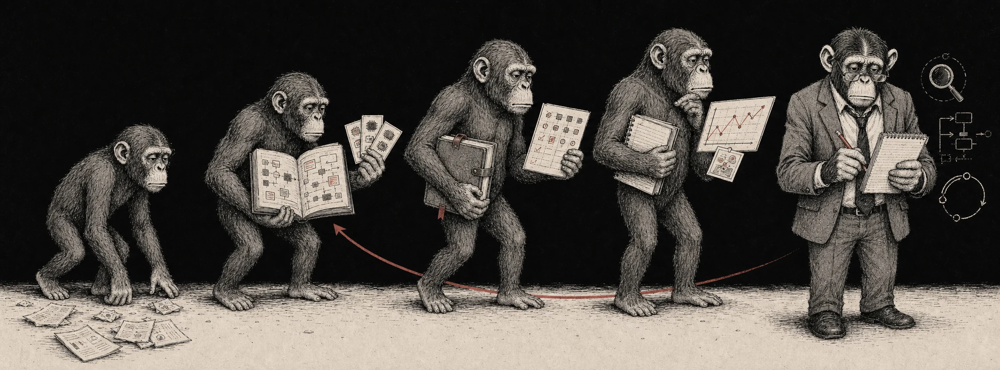

<div align="center">

# Guru Maker

**Turn your ape agent into an investing guru.**


[](https://github.com/monarchjuno/guru-maker/actions/workflows/ci.yml)


</div>

Your ape agent is capable but stateless between investment tasks. It can
produce a sharp investment thesis today, then rebuild the same context from
scratch next month—or ask you to paste its old answer back into the prompt.

Guru Maker gives that work a durable, project-owned memory. It becomes a guru
not because it always knows the answer, but because it remembers what it knew,
why it decided, and what happened next.

## Quick start

### 1. Install

For Codex:

```bash
codex plugin marketplace add monarchjuno/guru-maker
codex plugin add guru-maker@monarchjuno
```

For Claude Code:

```text
/plugin marketplace add monarchjuno/guru-maker
/plugin install guru-maker@monarchjuno
/reload-plugins
```

Start a new task or session after installation.

### 2. Initialize

From the project whose investment memory you want to grow:

```text
$guru-memory Initialize Guru Maker in this project.
```

In Claude Code, use
`/guru-maker:guru-memory Initialize Guru Maker in this project.` Guru Mode
starts as `auto` and retains only small, reviewable improvements. Set it to
`off` when every memory update should require an explicit request.

### 3. Ask naturally

```text
$guru-research Research this investment using current sources and relevant
project memory.
```

Pick the fitting public Skill and state what you want. No schemas or manual
record routing are required.

## Use it naturally

### 1. Give it a map

Start by researching a reusable part of the world:

```text
$guru-research Research the semiconductor manufacturing process. Retain the
reviewed, reusable process and value-chain map as a Wiki, including its scope
and limits.
```

The Wiki can preserve how wafer fabrication, HBM, advanced packaging,
substrates, testing, work in process, qualification lead times, shipments, and
revenue timing fit together. It keeps the stable causal map, not a permanent
view on any company or a stale market claim.

### 2. Make the next research task better

Later, ask a broad question:

```text
$guru-research Research fictional Atlas Silicon as an AI semiconductor
investment using current sources and relevant project memory.
```

| Without the Wiki | With the Wiki |
| --- | --- |
| Reconstructs the industry or gives a generic growth and valuation review. | Starts from the reviewed process map and spends the task on company-specific evidence. |
| Asks broadly about capacity and orders. | Traces bottlenecks across wafers, HBM, packaging, substrates, test, and qualified output. |
| May repeat old process research. | Reuses the stable map while re-checking every current company and market claim. |

The Wiki does not make Atlas Silicon bullish. It gives the agent a better map
of what to investigate and makes the remaining evidence gaps more precise.

### 3. Turn reviewed experience into a Lens

A material judgment can use that Wiki together with current Evidence:

```text
$guru-decision Should we initiate a position in Atlas Silicon? Record the
judgment, assumptions, risks, and invalidation conditions.
```

After the thesis has had time to meet reality:

```text
$guru-decision Review the outcome. Separate what the process got right from
what was luck, and preserve the later judgment without rewriting the first.
```

Suppose the review finds that demand was correctly identified but value accrued
elsewhere in the supply chain. That is a candidate lesson, not yet a rule. Test
it against an adjacent case and a counterexample:

```text
$guru-train Test whether this review supports a reusable constraint-migration
Lens. Record it only if the interpretation survives a counterexample, with
clear applicability, falsifiers, and limits.
```

If the lesson survives, the Lens can guide future research toward the binding
constraint, how quickly it can move, and where economic value accrues. It
guides the next investigation without dictating its answer.

## From ape to guru

The example above compounds through a reviewable loop:



**Wiki makes it informed. Lens makes it discerning. Decisions make it
accountable. Reviews make it better.**

This is capability growth, not a mandatory workflow. A factual question can
remain conversational. Research may stop with sourced Evidence or a reusable
Wiki. Only a material judgment becomes a Decision, and only a lesson that
survives review deserves to improve a Lens or Method.

## Generalize without overfitting

**Guru Maker escalates abstraction, not confidence.**

```text
One observation       ──X──> Universal Lens
One winning Decision  ──X──> Permanent rule

Repeated cases + counterexample + process-versus-luck review + explicit limits
                              └──> Reusable Lens or Method
```

- Put current observations and material judgments in point-in-time Evidence and
  Decisions.
- Put stable structure in Wiki and repeatable procedures in Method.
- Promote an interpretation to Lens only with counterexamples, applicability,
  falsifiers, and limits.
- Treat memory as context, not authority. Current claims still require current
  evidence.

The same contract applies across equities, rates, FX, crypto, technical, and
quantitative work. The semiconductor walkthrough is an example, not a required
workflow.

## Memory model

The host agent owns research, judgment, tools, and permissions. Guru Maker owns
the project-memory contract and deterministic operations around it.

Each project keeps five kinds of durable investment memory:

| Kind | Directory | Purpose |
| --- | --- | --- |
| **Wiki** | `guru-maker/wiki/` | Stable descriptive context, conventions, constraints, and domain knowledge |
| **Lens** | `guru-maker/lens/` | An interpretation, heuristic, or hypothesis with scope and limits |
| **Evidence** | `guru-maker/evidence/` | A provenance-bound observation or reproducible derived result at a stated time or data window |
| **Method** | `guru-maker/method/` | A repeatable research, calculation, model, or review procedure |
| **Decision** | `guru-maker/decision/` | A material judgment under stated information, constraints, and uncertainty |

Records stay as ordinary project-owned Markdown. See the
[knowledge model](docs/knowledge-model.md) for schemas, relationships,
point-in-time rules, retrieval, and Guru Mode behavior.

## Public Skills

Host agents discover five public Skills:

| Skill | Use it for |
| --- | --- |
| `guru-research` | Research with current evidence and relevant project memory. |
| `guru-memory` | Initialize, find, retain, correct, and curate memory or change Guru Mode. |
| `guru-decision` | Analyze, record, and review point-in-time judgments. |
| `guru-train` | Turn reviewed scenarios and corrections into reusable improvements. |
| `guru-packs` | Explicitly manage and share GitHub-backed data-only memory packs. |

## Documentation

- [Installation](installation.md)
- [Knowledge model and retrieval](docs/knowledge-model.md)
- [Decision memory and graph](docs/decision-memory.md)
- [Guru Pack contract](docs/community-plugins.md)
- [Architecture and product boundaries](docs/architecture.md)

## Development

See [CONTRIBUTING.md](CONTRIBUTING.md) and the
[development guide](docs/development.md).
